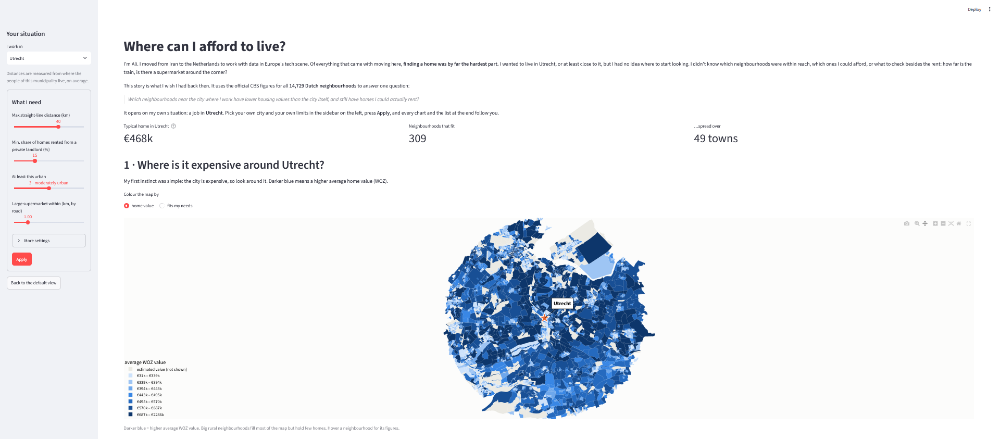
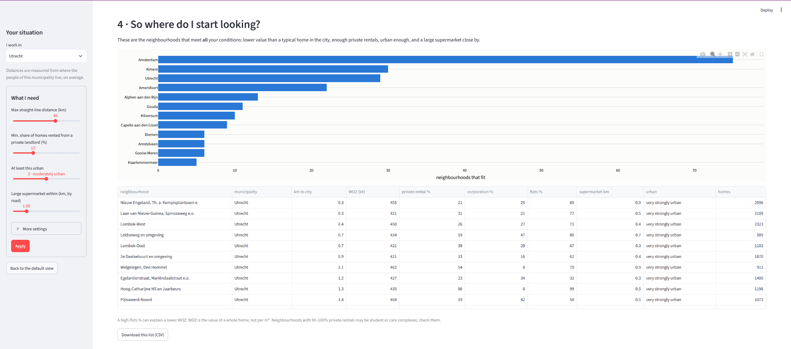

# Where can I afford to live? A data story for newcomers to the Netherlands

When I moved from Iran to the Netherlands to work in data, finding a home was by far the hardest part.
I wanted to live in or near Utrecht but had no idea where to start: which neighbourhoods were within
reach, which ones I could afford, and whether I could actually rent there.

This project turns the official CBS figures for all **14,729 Dutch neighbourhoods** into an interactive
story that answers one question:

> *Which neighbourhoods near the city where I work have lower housing values than the city itself,
> and still have homes I could actually rent?*

It opens on my own situation (a job in Utrecht); readers pick their own city and limits.
Built for the *Data-Informed Story* assignment of the Data & AI course at HU University of Applied
Sciences Utrecht.



## The story in four steps

| Step | The reader's question | What the data shows (default: Utrecht, 40 km) |
|---|---|---|
| 1 | Where is it expensive around my city? | The city is not the most expensive spot; the ring around it is. |
| 2 | Does moving further out make it cheaper? | Not at first: 10–20 km is the most expensive ring (median €551–578k vs €468k for a typical home in Utrecht). The median only drops below the city beyond ~35 km, and the spread at every distance is wider than that drop. |
| 3 | Can I actually rent there? | Only 14% of neighbourhoods within 40 km are both lower in value than the city and have at least 15% private rentals. |
| 4 | So where do I start looking? | 309 neighbourhoods in 49 towns, mostly Amsterdam, Almere, Utrecht itself and Amersfoort. |

The app ends with what I would do with that list, and with what this data **cannot** tell you:
rents, homes available today, travel time, or the size of a home (WOZ is per home, not per m²).



## Run the app

```bash
pip install -r requirements.txt
streamlit run app/app.py
```

Then open http://localhost:8501. The app needs **no internet**: all data is in `data/processed/`,
and the map is drawn without online map tiles. The first load takes a few seconds; after that,
changing a setting and pressing **Apply** updates every chart.

## How it was built

Four steps, each one a notebook or a script that runs top to bottom.
The output of one step is the input of the next.

| Step | File | What it does | Output |
|---|---|---|---|
| 1. Clean | `notebooks/01_cleaning.ipynb` | Reads the raw CBS export (long format) and the CBS/Kadaster neighbourhood map, turns them into one row per neighbourhood, handles missing values and outliers | `data/processed/buurten_story.csv` and `buurten_simplified.geojson` |
| 2. Profile | `notebooks/02_profile.ipynb` | Centre and spread of home values, one relationship (value vs distance to the city), where a summary misleads, what the data cannot tell | Numbers and caveats in `docs/appendix/03_statistical_profile.md` |
| 3. Storyboard | `notebooks/03_storyboard.ipynb` | The four static views of the story, the default view and how sensitive it is to each threshold | Images in `docs/storyboard/` |
| 4. Story | `app/app.py` | The interactive story: the reader picks a city and their own limits | The Streamlit app |

All rules of the story (the distance to the city, the thresholds of the default view) live in one
place, `app/helpers.py`. Steps 2, 3 and 4 all use it, so the notebooks and the app compute exactly
the same numbers.

## Data notes

Everything behind the story, in one document: **[docs/DATA_NOTES.md](docs/DATA_NOTES.md)**

| Part | File |
|---|---|
| Provenance and ethics | [00_provenance_ethics.md](docs/appendix/00_provenance_ethics.md) |
| Brief: question and audience | [01_brief.md](docs/appendix/01_brief.md) |
| Cleaning log | [02_cleaning_log.md](docs/appendix/02_cleaning_log.md) |
| Statistical profile and caveat | [03_statistical_profile.md](docs/appendix/03_statistical_profile.md) |
| Storyboard | [04_storyboard.md](docs/appendix/04_storyboard.md) |
| What the data cannot tell | [05_limits.md](docs/appendix/05_limits.md) |
| AI use | [06_ai_use_note.md](docs/appendix/06_ai_use_note.md) · [ai_build_log.md](docs/appendix/ai_build_log.md) |

---

# Part 1: Cleaning the CBS data

The story is built on an earlier cleaning project on the same data. The scripts in `src/` are kept
unchanged as the record of that first attempt; `notebooks/01_cleaning.ipynb` is the corrected and
extended version used by the story.

## 📊 Data Source

**CBS (Centraal Bureau voor de Statistiek)**: the Dutch national
statistics office; *Kerncijfers wijken en buurten 2025* (Key figures
for districts and neighborhoods), table **86165NED**.

- Official page: https://www.cbs.nl/nl-nl/cijfers/detail/86165NED
- Direct download: https://datasets.cbs.nl/CSV/CBS/nl/86165NED
- License: CC-BY 4.0

For the story I added the **CBS/Kadaster Wijk- en buurtkaart 2025 v1** (neighbourhood boundaries):
https://www.cbs.nl/nl-nl/dossier/nederland-regionaal/geografische-data/wijk-en-buurtkaart-2025

## 🎯 What the Cleaning Does

1. Loads CBS's raw export and reshapes it from a long (EAV) format
   into an analysis-ready wide table
2. Selects the measures relevant to housing: location, price, housing
   stock, ownership type (including the split between housing corporations
   and other landlords), and distance to amenities
3. Filters to neighborhood (*buurt*) level: 14,729 neighborhoods
4. Investigates and treats missing values
5. Detects outliers using the IQR method and adds capped copies of
   the affected columns
6. Joins the neighbourhood map and produces a 14,729-row table that keeps
   the real values and marks every imputed one

## 🧭 The Real Data Pipeline (and the problems solved along the way)

This section documents what actually happened, in order, including
the dead ends; because working through unexpected data problems is
the actual substance of a data cleaning project, not a footnote.

### 1. The download wasn't a CSV

The direct download link returns a file with a `.csv` extension, but
running `file` on it revealed it's actually a **ZIP archive**. Once
extracted, it contained 12 separate files, not one flat table:
`Observations.csv`, `MeasureCodes.csv`, `WijkenEnBuurtenCodes.csv`,
and several other dimension/metadata tables. CBS publishes this table
through its newer OData-style bulk export, not as a simple flat CSV.

### 2. The data is long (EAV), not wide

`Observations.csv` turned out to be a **1,596,799-row long-format
table**: each row is one `(region, measure, value)` triple, not one
row per neighborhood with all attributes as columns. To get a usable
housing table, I had to:

- Search `MeasureCodes.csv` (438 available measures) by keyword to
  find the exact codes for the measures I actually needed (e.g.
  `M001642` = average WOZ property value, `D000028` = distance to a
  GP practice)
- Pivot `Observations.csv` on those codes; separately for numeric
  measures (stored in the `Value` column) and text measures like
  region name/type (stored in `StringValue`), then join the two
  pivoted tables back together
- Join in the human-readable neighborhood name from
  `WijkenEnBuurtenCodes.csv`

This produced an 18,495-row wide table covering every region level
(country, municipality, district, neighborhood) at once.

### 3. Filtering to the right granularity

The wide table mixes four region levels in one file. I filtered to
`region_type == "Buurt"` (neighborhood), leaving **14,729 rows**, and
dropped `region_code`, a duplicate of the existing region identifier.

### 4. A data gap that turned out to be my own parsing bug

The five distance-to-amenity measures (distance to a GP practice,
supermarket, daycare, school, and number of schools within 3km) looked
**72–94% missing**. I first assumed CBS only publishes them at a higher
level, wrote `06_diagnostic_check_access_coverage.py` to check, saw the
same gap at district and municipality level, and concluded it was a
real gap in the 2025 release. I dropped the columns and used
`urbanity_level` and `address_density` as a proxy instead.

That conclusion was wrong. When I rebuilt the pipeline as a notebook
(`notebooks/01_cleaning.ipynb`) for the data story, the same rule
suddenly dropped zero columns. The cause: CBS writes decimals with a
comma (`1,2` km). `pd.to_numeric(..., errors="coerce")` does not read a
comma, and turns every such value into NaN **without a warning**.
Distances are the only measures with decimals, which is why only they
were hit, at every region level.

| Measure | values with a comma | missing, old way | missing, comma -> point |
|---|---|---|---|
| distance to supermarket | 16,251 | 91.9% | 0.0% |
| distance to GP practice | 16,174 | 91.5% | 0.0% |
| distance to daycare | 16,596 | 93.9% | 0.0% |
| distance to school | 16,410 | 92.8% | 0.0% |
| schools within 3km | 12,681 | 71.7% | 0.0% |

78,112 values were lost this way. No other measure contains a comma, so
the rest of the first pipeline is unaffected. What I take from it:
`errors="coerce"` hides errors, so I now always count how many values
it turned into NaN.

### 5. Missing values: three documented decision tiers

In the first pipeline, after dropping the five distance columns, the first
missing-value pass used a two-tier rule (impute under 10% missing,
drop columns over 40% missing) and left a gap: several genuinely
usable columns; average WOZ value, ownership %, building-age %,
dwelling-type %: sat in an untreated 10-25% missing range. Because
average WOZ value was also one of the "core fields" used to drop
rows, this silently dropped **1,838 neighborhoods** (12.5% of the
data) that were otherwise perfectly usable.

I revised the rule to a wider imputation tier (**under 25% missing →
impute with the municipality-level median**, rather than a national
median, since housing stock varies enormously between
municipalities). Re-running the pipeline with the corrected logic
recovered all of those neighborhoods: **0 rows were dropped** in the
final version. The notebook uses the same three tiers; with the comma
fixed, the distance columns now fall under the imputation tier (about
5% missing) instead of being dropped.

### 6. Outliers: flagged and capped in separate columns

Using the IQR method on the five unbounded numeric columns
(WOZ value, dwelling count, population, population density, address
density), 2.5%-5.7% of neighborhoods were flagged as outliers in
each column. A very expensive Amsterdam-canal neighborhood or a
nearly-empty rural buurt is real data, not an error, so nothing is
deleted and the original columns are never overwritten. The capped
(winsorized) values go into separate `*_capped` columns, for statistics
that are sensitive to extremes.

My first version overwrote the original columns with the capped values.
That quietly changed the data: hundreds of neighborhoods ended up with
exactly the same "maximum" WOZ value and population, the national
population total came out at 16.4 million instead of 18.0 million, and the most expensive municipality in the ranking was simply sitting on the cap.
Keeping both versions fixed that.

### 7. Marking what was estimated

Every value filled in by the municipality-median rule is listed in an
`imputed_fields` column (for example `avg_woz_value_k_eur;pct_rental`),
so anyone using the file can separate measured values from estimates.

## 📈 Results of the First Cleaning Project (`src/`)

| | Value |
|---|---|
| Raw observations (long format) | 1,596,799 rows |
| Total measures available | 438 |
| Wide table, all region levels | 18,495 rows × 23 columns |
| Neighborhood-level (Buurt) | 14,729 rows × 22 columns |
| After missing-value handling | 14,729 rows × 18 columns (0 rows dropped) |
| Final dataset (with `*_capped` columns) | 14,729 rows × 23 columns |
| Neighborhoods with at least one imputed value | 1,838 |
| Total population (real values) | 18,044,120 |
| Average WOZ property value (mean) | €444,994 |
| Average WOZ property value (median) | €418,000 |

The notebook version for the story (with the rental split and the distance
columns) has 1,842 neighbourhoods with at least one estimated value and the
same total population of 18,044,120.

**Top 5 most expensive municipalities** (mean neighborhood WOZ value, k€):
1. Laren (NH.): 1,188
2. Blaricum: 1,039
3. Wassenaar: 966
4. Bloemendaal: 863
5. Ouder-Amstel: 823

(All well-known high-income Dutch municipalities; a solid sanity
check that the pipeline produced sensible results.)

## 🗂️ Repository Structure

| Path | Purpose |
|---|---|
| `app/app.py` | The interactive story (Streamlit) |
| `app/helpers.py` | Shared rules: data loading, distance to the city, default thresholds |
| `notebooks/01_cleaning.ipynb` | Raw CBS export + map → `buurten_story.csv` (corrected pipeline) |
| `notebooks/02_profile.ipynb` | Statistical profile: centre, spread, one relationship, caveats |
| `notebooks/03_storyboard.ipynb` | Four storyboard views, default view and sensitivity table |
| `data/processed/buurten_story.csv` | Cleaned neighbourhood table used by the story |
| `data/processed/buurten_simplified.geojson` | Simplified neighbourhood shapes for the app |
| `docs/DATA_NOTES.md` | All data notes in one document (built by `docs/build_data_notes.sh`) |
| `docs/appendix/` | The separate notes: provenance, brief, cleaning log, profile, storyboard, limits, AI use |
| `docs/storyboard/` | Storyboard images |
| `docs/app/` | Screenshots of the app |
| `src/01_explore.py` … `src/09_summary_report.py` | The first cleaning pipeline (kept as the record of the first attempt) |
| `data/processed/nl_housing_clean.csv` | Output of the first pipeline (14,729 × 23) |
| `docs/before_*.png`, `docs/after_*.png` | Before/after outlier boxplots |

`data/raw/`, `data/interim/` and `data/geo/` are excluded via `.gitignore`; they're
large and fully reproducible with the commands below.

## 🚀 How to Reproduce Everything

```bash
conda create -n hu python=3.12 -y
conda activate hu
pip install -r requirements.txt

# 1. CBS statistics (a ZIP, despite the .csv name)
mkdir -p data/raw data/geo
curl -L -A "Mozilla/5.0" -o data/raw/86165NED.zip "https://datasets.cbs.nl/CSV/CBS/nl/86165NED"
(cd data/raw && unzip -o 86165NED.zip)

# 2. CBS/Kadaster neighbourhood map 2025
curl -L -o data/geo/WijkBuurtkaart_2025_v1.zip "https://geodata.cbs.nl/files/Wijkenbuurtkaart/WijkBuurtkaart_2025_v1.zip"
(cd data/geo && unzip -o WijkBuurtkaart_2025_v1.zip)

# 3. Notebooks, in order (each one runs top to bottom)
jupyter nbconvert --to notebook --execute --inplace notebooks/01_cleaning.ipynb
jupyter nbconvert --to notebook --execute --inplace notebooks/02_profile.ipynb
jupyter nbconvert --to notebook --execute --inplace notebooks/03_storyboard.ipynb

# 4. The app
streamlit run app/app.py
```

To rerun the first pipeline instead, run the scripts in `src/` in order from inside `src/`
(`05` and `06` document the first attempt and the diagnostic; the final pipeline uses `07`).

## 🛠️ Tech Stack

Python · Pandas · NumPy · GeoPandas · Matplotlib · Seaborn · Plotly · Streamlit · Jupyter

## 📬 Contact

Ali Baghdadi · [LinkedIn](https://linkedin.com/in/alibaghdadi) · alibaghdadi1368@gmail.com