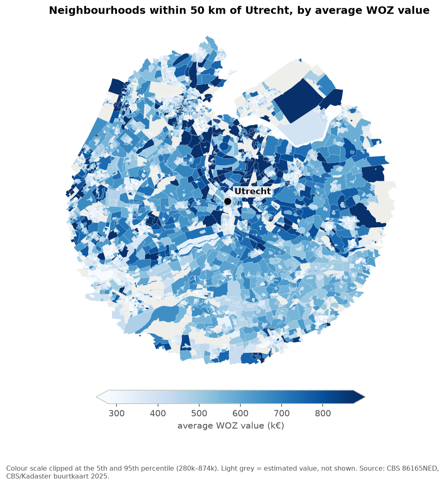
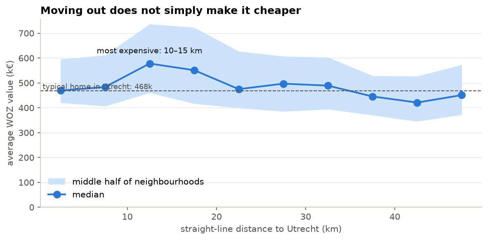
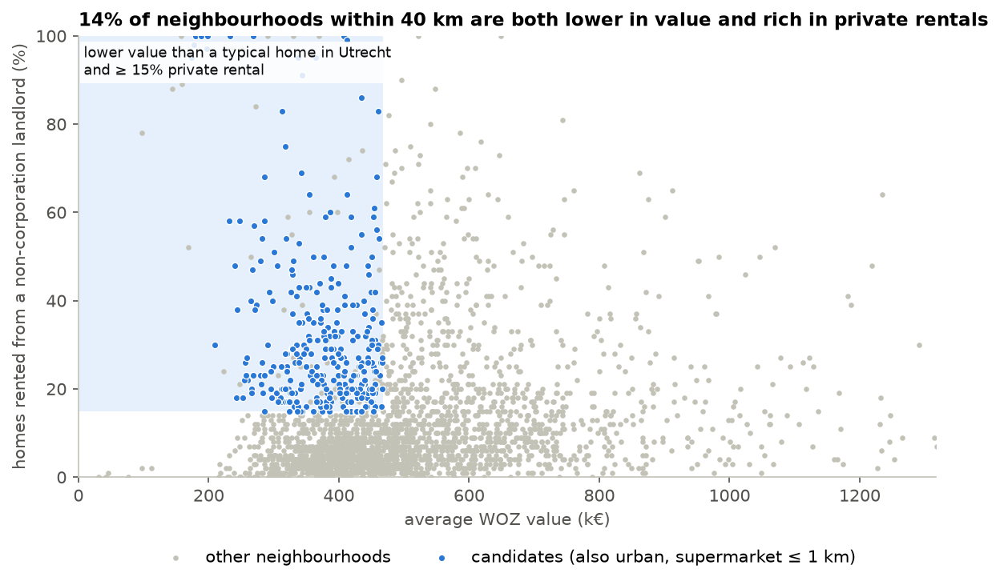
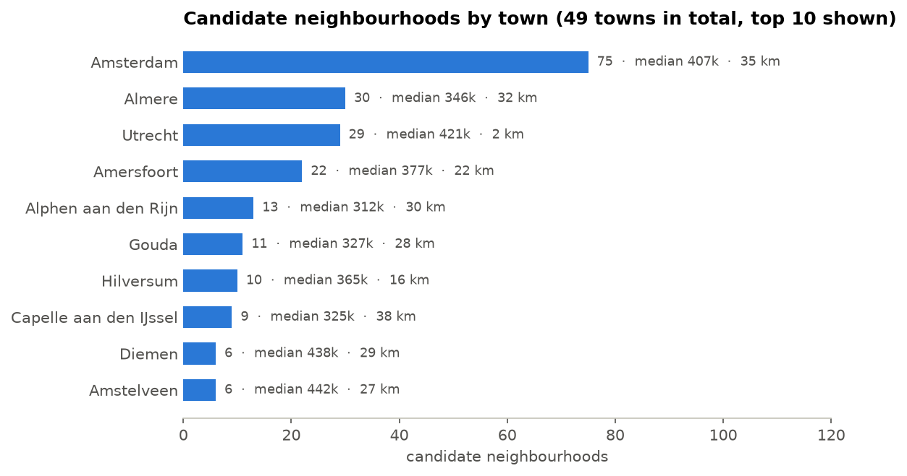

# Data notes: Where can I afford to live?

Ali Baghdadi · HU Utrecht · Data & AI · A Data-Informed Story

Generated 2026-10-17 from the files in `docs/appendix/`.

**Contents:** 0 Provenance and ethics · 1 Brief · 2 Cleaning log · 3 Statistical profile · 4 Storyboard · 5 Limits · 6 AI use · Appendix: AI-build log

---

# Provenance and ethics

## Where the data comes from

| | Statistics | Neighbourhood map |
|---|---|---|
| Name | Kerncijfers wijken en buurten 2025 (table 86165NED) | Wijk- en buurtkaart 2025, version 1 |
| Publisher | CBS (Statistics Netherlands) | CBS, municipal boundaries from Kadaster |
| Where | https://www.cbs.nl/nl-nl/cijfers/detail/86165NED, bulk download https://datasets.cbs.nl/CSV/CBS/nl/86165NED | https://www.cbs.nl/nl-nl/dossier/nederland-regionaal/geografische-data/wijk-en-buurtkaart-2025 |
| What I got | A ZIP (despite the .csv name) with 12 files; Observations.csv has 1,596,799 rows in long format | A ZIP with one GeoPackage: layers buurten (14,823 shapes), wijken, gemeenten |
| Downloaded | 2026-09-13 | 2026-10-16 |
| Licence | CC BY 4.0: free to reuse with credit to CBS | Free to reuse with credit to CBS and Kadaster |
| How | Direct download, no scraping, no login | Direct download, no scraping, no login |

Both raw downloads are kept out of Git (too large); the README has the exact download commands, so anyone can rebuild everything from scratch with `notebooks/01_cleaning.ipynb`.

## Why this source

I needed something that covers **every** neighbourhood in the country with the same definitions. CBS is the official statistics office and publishes one consistent table for all 14,729 neighbourhoods. Housing websites have rents, but only for homes on offer right now, without definitions, and their terms do not allow scraping. I chose a source I can defend over one that has the exact number I wanted (rent).

## Personal data and privacy

- There is no data about people or single homes in this project, only neighbourhood totals and averages.
- CBS already protects privacy at the source: no average WOZ for neighbourhoods with fewer than 20 homes, and no ownership figures where too few homes are known. That is why 1,692 neighbourhoods have no rental figures (see the cleaning log).
- I do not combine this with any other data that could point to a person or a household.

## Ethical choices I made

1. **No "cheap" or "bad" labels.** A neighbourhood is the home of real people. The app never ranks neighbourhoods from best to worst and never calls a place cheap or poor; it says "lower value than a typical home in the city", which is what the data measures.
2. **Average is not a person.** A low average WOZ says nothing about any single home or household living there. The app says this in its limits section, so nobody draws conclusions about the people in a neighbourhood.
3. **Estimates are marked.** 1,842 neighbourhoods have at least one value filled with the municipality median. They are left out of the shortlist by default and labelled "(estimated)" when shown.
4. **My point of view is built in.** The story starts from my own situation: a newcomer with a job who needs a private rental. A student, a family or someone on a waiting list for social housing would need different criteria. The sidebar lets readers change the thresholds, but the questions are still mine.
5. **A tool can push people to the same places.** If many newcomers use the same shortlist, they all look in the same neighbourhoods, which could add to the pressure there. At the scale of a course project this is small, but it is a reason to show a wide list and the reader's own criteria rather than a single "best" answer.
6. **The data has an age.** These are 2025 figures and WOZ is a valuation with a reference date in the past. Values and rental shares change; the app shows the year in its sources.

---

**Audience:** newcomers to the Netherlands who just got a job in a Dutch city and need a place to
live within weeks, like I did when I moved from Iran to work in data. The default view of the app
is my own situation: a job in Utrecht.
---

# Cleaning log

Every decision, in the order it happened. Numbers come from `notebooks/01_cleaning.ipynb` (section 10).

| #    | Date       | What I found                                                 | What I decided                                               | Why                                                          |
| ---- | ---------- | ------------------------------------------------------------ | ------------------------------------------------------------ | ------------------------------------------------------------ |
| 1    | 2026-09-21 | The "CSV" download was a ZIP with 12 files; Observations.csv is long format (1,596,799 rows) | Pivot to one row per region                                  | Analysis needs one row per neighbourhood                     |
| 2    | 2026-09-21 | 4 region levels mixed in one table (18,495 rows)             | Keep `Buurt` only (14,729)                                   | Higher levels would count people twice                       |
| 3    | 2026-09-21 | WOZ, ownership and building-age columns 10-25% missing; my first <10% rule silently dropped 1,838 neighbourhoods | Fill <25% missing with the municipality median, list every filled value in `imputed_fields` | Housing differs more between municipalities than within one; 0 rows dropped |
| 4    | 2026-09-21 | IQR outliers 2.5-5.7% per column; my first version overwrote the real values | Keep real values, add `*_capped` copies                      | Expensive or empty neighbourhoods are real, not errors       |
| 5    | 2026-10-16 | `pct_rental` mixes social housing (years of waiting) with private rentals | Added `A047047` corporation and `A047048` other landlords    | A newcomer can realistically only use the private part       |
| 6    | 2026-10-16 | Ownership block missing for 1,692 neighbourhoods (11.5%), always all three columns together | Same municipality-median rule, marked in `imputed_fields`    | CBS leaves the whole block out, most likely for very small neighbourhoods |
| 7    | 2026-10-16 | Corporation + other landlords = total rentals, gap never more than ±1 | Accepted the split as consistent                             | ±1 is rounding of whole percentages                          |
| 8    | 2026-10-16 | Map has 14,823 shapes, my table 14,729; the 94 extra are 93 water areas and 1 "abroad" | Left those 94 out; all 14,729 neighbourhoods found a shape   | They have no inhabitants and no statistics                   |
| 9    | 2026-10-16 | **Distance measures were not missing: CBS writes decimals with a comma and `errors="coerce"` silently made 78,112 values NaN** | Convert comma to point before `to_numeric`, count what still fails (0) | My earlier "data gap" conclusion was a parsing bug; distances are now usable (5.3% filled) |
| 10 | 2026-10-16 | CBS has no distance-to-station measure, and the five amenity distances do not say how far a place is from where you work | Derived `dist_to_city_km`: straight line from each neighbourhood's centre point (`representative_point`, RD metres) to the population-weighted centre of the chosen city (`app/helpers.py`) | No hand-typed coordinates; the same function is used in the notebooks and the app |
| 11 | 2026-10-16 | 1,842 neighbourhoods carry an estimated value (municipality median) | For profiling and the shortlist, use measured values only; estimates are kept in the file and shown separately | An estimate pulls a neighbourhood towards its municipality and would hide real differences; including them changes band medians by at most 13.5k and the shortlist by 1 neighbourhood |
| 12 | 2026-10-16 | Every row is a neighbourhood, whether it has 15 homes or 3,000; the smallest quarter holds only 2.5% of homes but is more expensive | Report "typical home" as a median weighted by `dwelling_count`; Utrecht's typical home = 468k | A newcomer is looking for a home, not a neighbourhood; unweighted, the national median is 13% too high (422k vs 374k) |
| 13 | 2026-10-16 | Tiny neighbourhoods give unstable averages | Shortlist only uses neighbourhoods with at least 50 homes | Barely changes the result (20 homes: 314, 50: 309, 100: 305), so it is a safety rule, not a driver |
| 14 | 2026-10-16 | The shortlist depends on thresholds I chose | All thresholds in one place (`DEFAULTS` in `app/helpers.py`) and a sensitivity table in `03_storyboard.ipynb` | Every number in the app can be traced and defended |

**Result:** 14,729 neighbourhoods, total population 18,044,120, 1,842 neighbourhoods with at least one estimated value.

---

# Statistical profile

Source: `notebooks/02_profile.ipynb`. Measured values only (12,891 neighbourhoods).

## Centre and spread: average WOZ value per neighbourhood

| | value |
|---|---|
| median | 422k |
| mean | 450k |
| middle half (Q1-Q3) | 333k - 528k (IQR 195k) |
| range | 31k - 2,286k |
| skew | 2.0 |

The mean sits above the median because a few very expensive neighbourhoods pull it up. I report the median.

## One place where a summary misleads

| | per neighbourhood | per home (weighted by dwellings) |
|---|---|---|
| median | 422k | 374k |
| mean | 450k | 397k |

Counting every neighbourhood once overstates a typical home by about 48k (13%). The smallest quarter of neighbourhoods holds 2.5% of all homes but has a median of 515k against 393k for the rest: villages and rural areas with large houses get the same weight as city districts.

## One relationship: value and distance to Utrecht

| distance | 0-5 | 5-10 | 10-15 | 15-20 | 20-25 | 25-30 | 30-35 | 35-40 | 40-45 | 45-50 km |
|---|---|---|---|---|---|---|---|---|---|---|
| median WOZ (k) | 469 | 484 | 578 | 551 | 475 | 497 | 489 | 446 | 421 | 451 |

Not a steady fall: the 10-20 km ring is the most expensive, and only beyond ~35 km is the median below the city. Spearman = -0.17 (n = 4,454), which on its own would suggest "almost no relationship" and hide the hump. Within every band the middle half spans 150-280k, more than the change in the median across 50 km.

Private rentals: median 20% inside the city, 8-12% further out.

## Caveat

All band medians count neighbourhoods, not homes, so their level is somewhat too high (see above); I rely on the shape, not the exact numbers.

---

# Storyboard

Source: `notebooks/03_storyboard.ipynb`. Images in `docs/storyboard/`.
Format: interactive narrative (Streamlit). Audience: an international newcomer who just got a job in a Dutch city.

| # | reader's question | view | what the reader should conclude |
|---|---|---|---|
| 1 | Where is it expensive around my city? |  | The city is not the most expensive spot; the ring around it is. |
| 2 | Does moving out make it cheaper? |  | Not until ~35 km, and distance alone is a poor guide. |
| 3 | Can I rent there? |  | Only 14% of neighbourhoods within 40 km are both lower in value and have ≥15% private rentals. |
| 4 | Where do I start? |  | 309 candidates in 49 towns, mostly Amsterdam, Almere, Utrecht itself and Amersfoort. |

## Default view

Defined in `DEFAULTS` (`app/helpers.py`); reasons and sensitivity in the last section of `03_storyboard.ipynb`.

## What changed because of the data

I expected the answer to be "move further out". The data says the cheaper parts of Utrecht and of the larger cities nearby are where lower values and private rentals meet. And a lower WOZ there can simply mean smaller flats, because WOZ is per home, not per m2.

---

# What this data does NOT let me conclude

| Limit | Why | How the story handles it |
|---|---|---|
| **Rent** | WOZ is the municipality's valuation of a home for tax, not a rent or an asking price | The story only says "lower housing value", never "cheaper to rent" |
| **Availability** | A private-rental share says those homes exist, not that one is free today | Step 5 in the app tells the reader to search the shortlisted areas themselves |
| **A single home** | All figures are neighbourhood averages | Stated in the app's limits; no claims about individual homes or people |
| **Travel time** | Distance is a straight line to the population-weighted centre of the city; CBS 86165NED has no distance to train stations | The app tells the reader to check the real journey before choosing |
| **Size of the home** | WOZ is per home, not per m²; areas with many small flats look cheaper | The shortlist shows "flats %" next to every neighbourhood |
| **Social housing** | "Owned by a housing corporation" is about the owner; CBS did not look at the rent | Only the private-rental share is used as "rentable for a newcomer" |
| **Which supermarket** | "Large supermarket" = any shop of ≥150 m² selling daily goods, by road; not a specific chain | Labelled "large supermarket" in the app |
| **Per neighbourhood, not per home** | Each neighbourhood counts once in the distance bands; nationally this puts the median about 13% too high (422k vs 374k) | The "typical home in the city" uses a home-weighted median; for the bands I rely on the shape, not the exact level |
| **Cause** | The hump by distance is a pattern; house type, age and demand all change with distance too | Described as a pattern, never as "distance makes it cheaper" |
| **Odd neighbourhoods** | Some areas are 90-100% privately rented: probably student or care complexes, the data cannot tell | Flagged in the app as "check these yourself" |
| **Time** | 2025 release; prices and shares change | Year shown in the sources |

---

# AI-use note

I used Claude (Anthropic) as an assistant during this project. The step-by-step record is in `ai_build_log.md`; this note is the summary.

## What AI helped with

- **Finding and understanding the data.** It pointed me to CBS as a reliable source for Dutch neighbourhood data, explained the Dutch names of the measures, and helped me understand the EAV (long) format, which I had never worked with before, and how to turn it into one table.
- **Code.** It helped me draft code for the notebooks and the Streamlit app, which I ran, read and tested on my own laptop.
- **Debugging.** It suggested the hypothesis behind my biggest finding (the decimal comma that `errors="coerce"` silently turned into missing values), and it found why the app was slow and why the map was blank without internet.
- **Documentation.** It helped with grammar and sentence structure in my notes, captions, the story text in the app and these appendix files. English is not my first language.

## What was mine

- The question and the audience: my own search for a home after moving from Iran to work in data, wanting to live in or near Utrecht.
- Choosing the measures I needed for that question, and the first cleaning project (`src/`), which this project builds on.
- Running every notebook and the app on my own laptop, and reading every output.
- The decisions: changing the story when the data showed a hump instead of a steady fall, keeping the city's own neighbourhoods in the shortlist, and the default thresholds after looking at the sensitivity table.
- The content of the text: findings, decisions and numbers. Where a corrected sentence did not sound like me, I rewrote it.

## How I checked AI output

- **Restart & Run All** on all three notebooks before submitting.
- **Totals that must not change:** 14,729 neighbourhoods and a total population of 18,044,120, the same as in my first project.
- **Every number in my text** is copied from notebook output, not from the chat.
- **Measure meanings** checked against CBS's own descriptions in `MeasureCodes.csv`.
- **Sanity checks in the data:** corporation + other landlords = total rentals (±1); the comma comparison table (old method vs new method).
- **The app against the notebook:** the default view shows 309 candidates, the same as `03_storyboard.ipynb`.
- **Real-world tests:** wifi off, dark and light theme, full-size data.

## What I corrected or rejected

- My own earlier claim that CBS did not publish distance data: it was a parsing bug.
- The first map (Plotly geo), because it needs the internet.
- Presenting the housing shortage as a finding; it stays my personal experience, because my data does not measure it.

---

# AI-build log

Assistant: Claude (Anthropic), used as a chat assistant. I ran every command and notebook myself on my own laptop.

| # | Date | What I asked for | What I kept | What I fixed, changed or rejected | How I checked it |
|---|---|---|---|---|---|
| 1 | 2026-09-13 | Where I can find reliable data about homes and neighbourhoods in the Netherlands | CBS *Kerncijfers wijken en buurten 2025* (table 86165NED) as my source | Chose the official statistics office, which covers every neighbourhood with the same definitions, over housing websites | Opened the CBS page myself, checked the licence (CC BY 4.0) and downloaded the data on 2026-09-13 |
| 2 | 2026-09-13 | The data was in Dutch, so I asked for an explanation of the measures (e.g. *Gemiddelde WOZ-waarde*, *Huurwoningen*, *Mate van stedelijkheid*) to understand what each one means | The meanings, which I used to choose my measures and name my English columns | - | Compared with CBS's own descriptions in `MeasureCodes.csv` (shown in notebook 02, section 0) |
| 3 | 2026-09-13 | The data came in EAV (long) format, my first time working with this kind of data. I asked for help to explore it and to understand how to combine it into one table | Searching `MeasureCodes.csv` by keyword; pivoting numbers (`Value`) and text (`StringValue`) separately and joining them | Built the steps as separate scripts in `src/` so I could check each one | Wide table of 18,495 rows with 4 region levels; 14,729 neighbourhoods after keeping only `Buurt` |
| 4 | 2026-10-16 | Why the new notebook dropped 0 columns while my old script dropped 5 | Hypothesis: decimal comma + `errors="coerce"` | **Corrected my own earlier conclusion** ("CBS has no distance data") in the README and cleaning log | Ran the comparison myself: 78,112 of 88,385 distance values had a comma; old method 72-94% missing, new method 0% |
| 5 | 2026-10-16 | A statistical profile notebook | Per-home vs per-neighbourhood median, distance bands, sensitivity check | The relationship turned out to be a hump, not a fall; I changed the story because of it | Numbers in my notes are copied from the notebook output, not from the chat |
| 6 | 2026-10-16 | A Streamlit app from the storyboard | 5-step layout, sidebar from `DEFAULTS`, CSV export | **First map was blank without internet** (Plotly geo loads a base map online): replaced by plain shapes | Turned wifi off and reloaded; app shows 309 candidates, same as notebook 03 |
| 7 | 2026-10-16 | The app was very slow on my real data | Shapes prepared once, map drawn as one image with invisible hover points, an Apply button | The first test used 120 neighbourhoods, so the problem only showed at full size | Timed the first load and a setting change on my laptop |
| 8 | 2026-10-16 | Text was invisible in dark theme; city marker hard to see | Charts on a light card with dark text; orange star with a boxed label | - | Checked in both light and dark theme |
| 9 | 2026-09-13 to 2026-10-16 | Help with documentation: grammar and sentence structure in my notes, captions, the story text in the app and these appendix files (English is not my first language) | Corrected grammar and clearer sentence structure | The content is mine: findings, decisions and numbers. I rewrote sentences that did not sound like me | Every number in the text checked against the notebook output |
